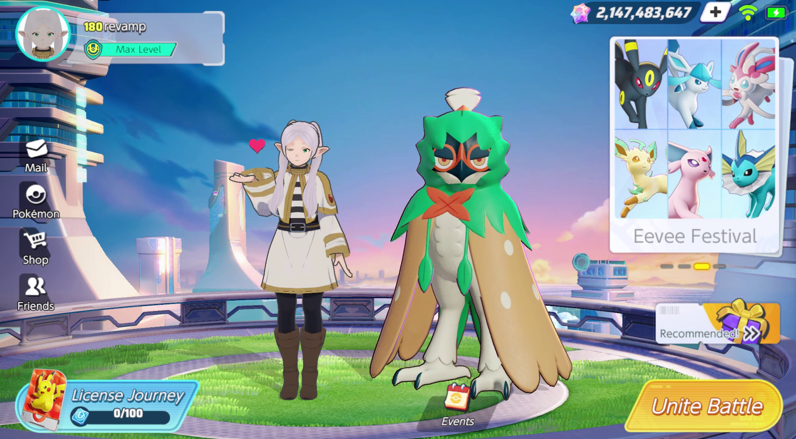
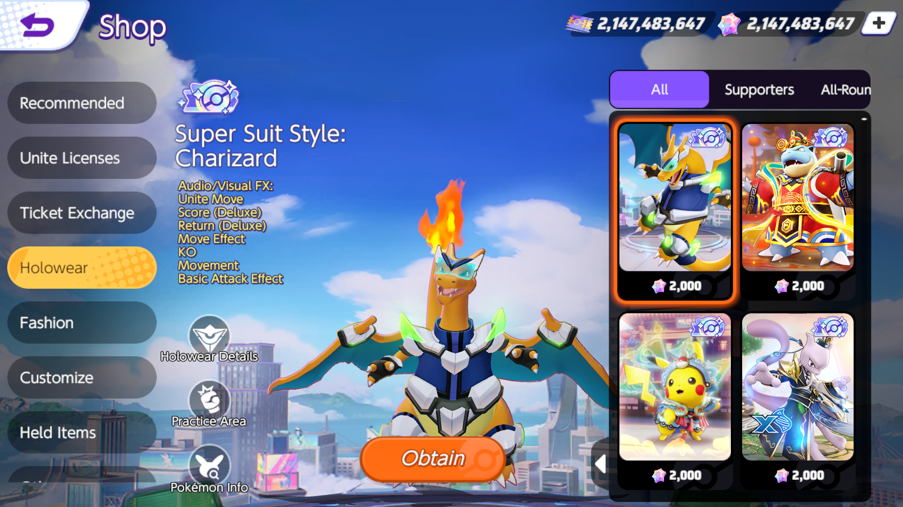
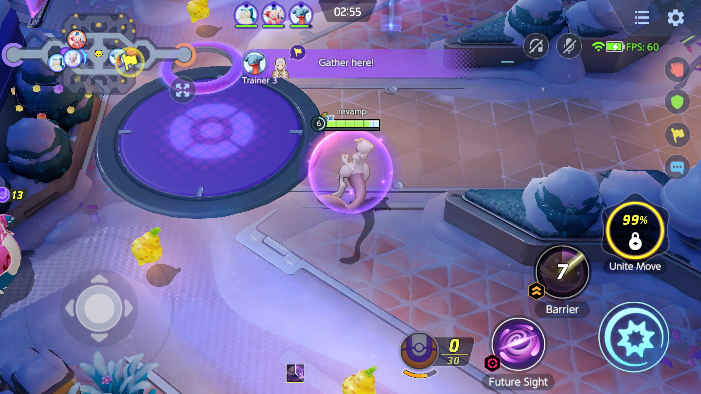

# SpiritUNITE

SpiritUNITE is a C# server emulator for the [Pokemon UNITE](https://en.wikipedia.org/wiki/Pok%C3%A9mon_Unite) client. The official service ends on **March 23, 2027**.

## Gallery

### Lobby


### Shop


### Battle


## Prerequisites

- You will need your own APK or decrypted IPA.

## Environment Setup

1. Clone the repository
2. Install the [.NET 10 SDK](https://dotnet.microsoft.com/download/dotnet/10.0)
3. Install [MariaDB](https://mariadb.org/download/)
4. Install [Python 3](https://www.python.org/downloads/)
   - Make sure to tick `Add to PATH` while installing. You can check by running `python --version` in your terminal.
5. Install JDK 17+ to build the APK. Make sure `java` and `keytool` are on your PATH.
6. For local testing, install Android SDK Platform-Tools and put `adb` on your PATH.

## Server Setup

1. Create the database and its tables.
   ```powershell
   # Windows
   cmd /c "mariadb -u root -p < sql/spiritunite.sql"
   ```
   ```sh
   # Linux
   mariadb -u root -p < sql/spiritunite.sql
   ```

2. Copy the example settings and put your database user and password in the connection string.
   ```powershell
   # Windows
   copy src/SpiritUnite.Core/appsettings.example.json src/SpiritUnite.Core/appsettings.json
   ```
   ```sh
   # Linux
   cp src/SpiritUnite.Core/appsettings.example.json src/SpiritUnite.Core/appsettings.json
   ```

3. Download the game resources (see [Download the Game Resources](#download-the-game-resources)). The game downloads about 7 GB from your server on first launch and checks it on every start, so players cannot get past "Checking update data" without it.


4. Build and start the server from the root directory.
   ```powershell
   dotnet run --project src/SpiritUnite.Core
   ```

5. Open the admin panel at the address printed at startup (`http://127.0.0.1:10081/admin` by default, `https://your.domain/admin` when hosting) and log in with the new token printed on every start.

## Download the Game Resources

Your server hands players the files the game downloads on first launch: one resource archive per platform and the shop, outfit and event images. Get them from the official servers while they are still up (until March 23, 2027). No APK is needed.

```powershell
# Windows
python tools/fetch_resources.py archives
python tools/fetch_resources.py images
```
```sh
# Linux
python3 tools/fetch_resources.py archives
python3 tools/fetch_resources.py images
```

- `archives` downloads the Android (about 7.8 GB) and iOS (about 7.7 GB) archives into `resources/1169/` and `resources/1170/`. Use `--platform android` or `--platform ios` for just one.
- `images` downloads about 1.3 GB of images into `resources/images/`.
- If a download stops, run the same command again to continue.

Files go in the folder set by `ResourceArchive.Directory` in `appsettings.json` (`resources/` by default). See [resources/README.md](resources/README.md) for the layout.

## Build the APK

1. Put your own official `base.apk`, `split_ab.apk` and `split_config.arm64_v8a.apk` in one folder. Build `1192039` is currently supported.
2. For local testing, run this from the root directory:
   ```powershell
   # Windows
   python tools/build_apk.py --apks "path/to/splits" --dev
   ```
   ```sh
   # Linux
   python3 tools/build_apk.py --apks "path/to/splits" --dev
   ```
   The script uses your server settings, creates a signing key and offers to download Android build tools if needed. Back up the signing key so future builds can update installed clients.


3. Run the printed `adb install -g` command. The app shows up as **SpiritUNITE**; use `--label` to change the name.
4. With the default local settings, run the printed `adb reverse` commands to connect your device to the server. Repeat these after restarting.
5. Start the server and launch the game.

## Ports

| Port | Server |
| :--- | :--- |
| 8085 | Update server (resource update check on every start) |
| 8700 | Voice chat (UDP) |
| 10001 | Directory server |
| 10002 | Lobby server |
| 10003 | Relay server (UDP) |
| 10081 | Login, Registration, and Admin pages, and the resource archive download |

All of these can be changed in `appsettings.json`, except the update server. The client only looks for it on port 8085 or 8080.

### Hosting for Others (Remote Play)

For friends to connect, use a domain pointing to your server and a publicly trusted HTTPS certificate.


1. In `appsettings.json`, set `LobbyServer.Host` to your domain.
   ```json
   "LobbyServer": {
     "Host": "play.example.com",
     "Port": 10002
   }
   ```

2. Set `TcpServer.BindAddress` to `0.0.0.0` so the directory, lobby, update and relay servers accept outside connections. Keep `127.0.0.1` for local development.
   ```json
   "TcpServer": {
     "BindAddress": "0.0.0.0",
     "MaxConnections": 100,
     "IdleTimeoutSeconds": 120,
     "RegistrationIdleTimeoutSeconds": 900
   }
   ```

3. Set up HTTPS for your domain and open your ports. Follow the [nginx hosting guide](deploy/README.md).


4. Choose where players download the resource archive. In `appsettings.json`:
   - Leave `"BaseUrl": ""` for local development.
   - For hosting, set it to your domain (or CDN). Serve `/resources/` over plain HTTP on port 80, not redirected to HTTPS:
   ```json
   "ResourceArchive": {
     "Directory": "resources",
     "BaseUrl": ""
   }
   ```


5. Build the client for your domain:
   ```powershell
   # Windows
   python tools/build_apk.py --apks "path/to/splits" --host play.example.com
   ```
   ```sh
   # Linux
   python3 tools/build_apk.py --apks "path/to/splits" --host play.example.com
   ```
